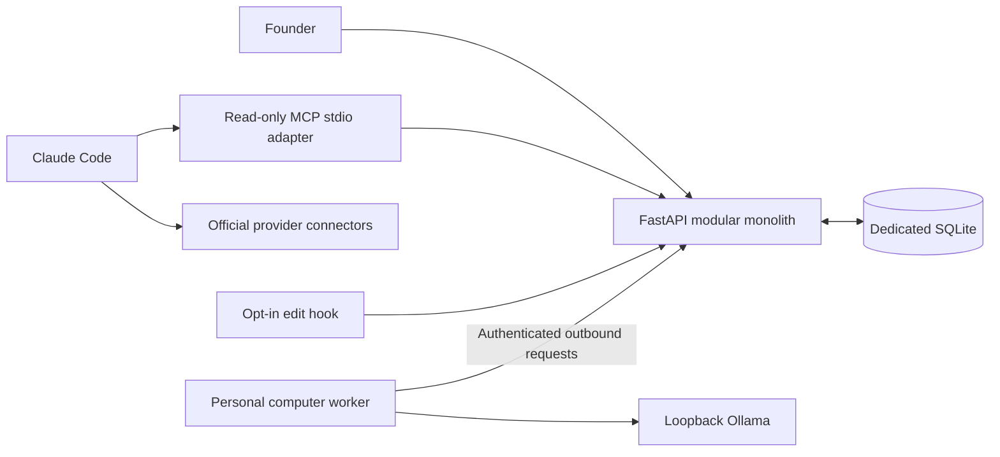
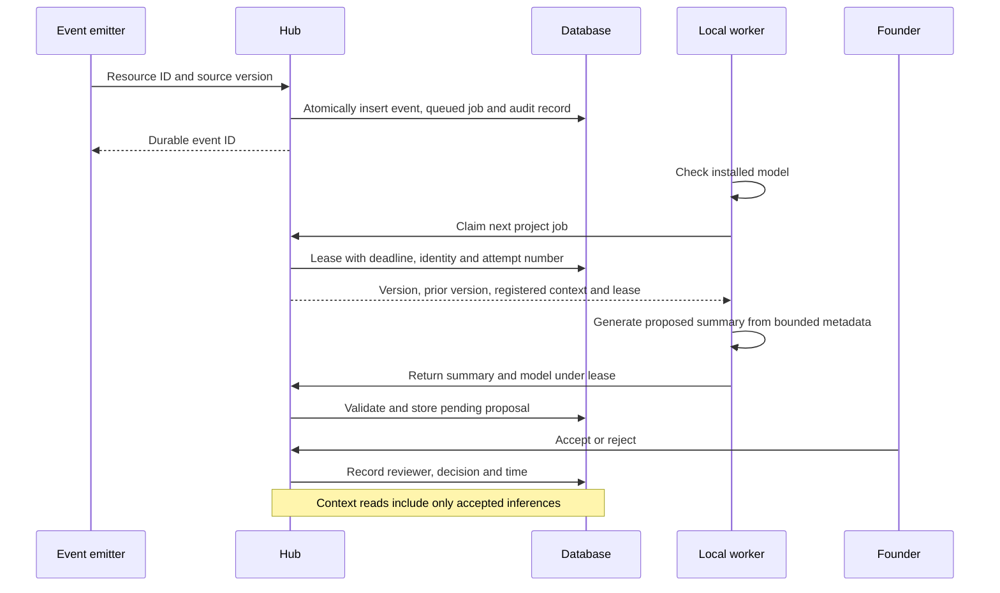

# Architecture

The Founder sets requirements and owns strategic decisions. The brief assigns engineering to Claude Code, gives Ollama an advisory role and treats GPT as an external consultant. Each AI keeps its official provider connectors. The Hub stores knowledge about those systems.

## Storage and provenance

| Table | Identity and responsibility |
|---|---|
| identities | One credential digest, role and project scope per principal. Stable ID survives rotation. |
| projects | Stable ID and display name. |
| resources | Composite project/resource key. Components, documents and repository paths share a reference model with optional provider and environment, source locator, receipt time and authority label. |
| links | Typed, directional edges. Both endpoints and evidence reference resources in the same project. |
| events | Immutable received facts, deduplicated by project, authenticated principal and external ID. Receipt time is server time in Unix seconds. |
| jobs | One job per event. Status, attempt count, lease owner and expiry survive restart. |
| proposals | One immutable summary per event plus a single Founder review. Event links supply version and source. Subsequent events produce separate versions. |
| audit | Actor, action, project, reference and timestamp written in the same transaction as the action. Access restricted to administrators and project Founders. |

Resource summaries and links are Founder-registered observations. Authority labels such as `APPROVED_SPECIFICATION` refer to the Founder's designation. Returning a source does not prove that the Hub independently checked it. A subsequent event marks a resource as needing review. Accepted AI text remains inferred, carries `OLLAMA_OBSERVATION`, and never replaces the registered resource. The payload and lease bind the update to one event. Source contents cannot authorize new actions.

Context uses case-insensitive substring search with exact IDs first (SQLite lowercasing is ASCII-oriented). It returns up to five resources, five adjacent edges with locators per resource, two recent changes and two accepted summaries per resource. Older records remain in storage. There is no cache. A test on the development host returned one resource, 517 bytes of MCP result text in about 25 ms after handshake. This is a fixture measurement. Token savings, search quality across real projects and avoided exploration require workload measurements.

The slice includes review/status APIs. A browser dashboard, automated source verification, semantic search, multi-resource diff analysis and staging QA/Virtual Player remain future work. The local worker sees metadata and hashes. Detailed behavioral changes generally require opening cited sources through the agent's official connector.
