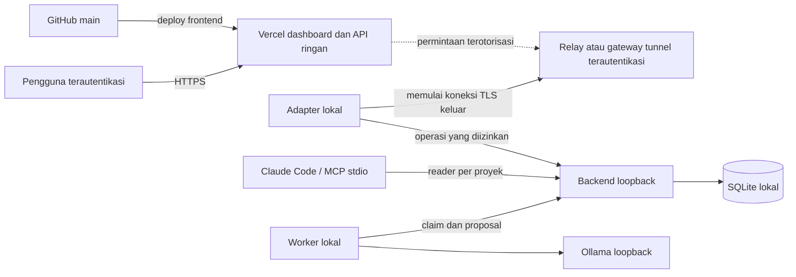

# ADR 0002 · Vercel dan komputer pribadi

**Tanggal:** 23 November 2026. **Otoritas:** `USER_DECISION`, Founder Vanillate Studio. **Status:** topologi dan database disetujui. Desain transport, parameter operasional dan pengujian di bawah adalah usulan implementasi. Penerapan produksi belum dilakukan.

## Keputusan resmi

| Lokasi | Tanggung jawab |
|---|---|
| GitHub → Vercel | Deploy frontend/dashboard dari branch produksi main. Vercel Functions menangani permintaan singkat seperti pemeriksaan sesi, validasi input dan penerusan permintaan baca yang diizinkan. Build hanya memuat aset frontend yang diizinkan untuk audiensnya. Preview menggunakan konfigurasi terpisah. |
| Komputer pribadi | Backend lokal memvalidasi izin, mencatat audit dan menjadi pemilik akses SQLite. Komputer juga menjalankan Local AI Indexer, background worker, Ollama, serta MCP stdio untuk klien yang memerlukannya. Aktifkan kembali layanan setelah boot/login sesuai OS. |
| SQLite lokal | Satu sumber data otoritatif untuk registri, relasi, keputusan, event, pekerjaan, proposal dan riwayat. Contoh path pada disk lokal adalah data/agent-hub.db. Direktori database, WAL, SHM, snapshot dan cadangan dikecualikan dari Git dan artefak build/deploy. |
| Infrastruktur Vanillate lain | VPS produksi bot utama tetap terisolasi. Cloudflare Pages, Workers, D1, Queues dan R2 dikecualikan dari infrastruktur Agent Hub. Referensi ke layanan proyek lain dalam Atlas tetap sah sebagai metadata. |

Durasi invokasi Functions terbatas dan filesystem runtime bukan penyimpanan persisten untuk Hub. Deploy frontend dari GitHub tidak berarti menjalankan migrasi, memindahkan SQLite, atau menjalankan worker dari build. [Vercel Functions limitations](https://vercel.com/docs/functions/limitations) · [Vercel Git deployments](https://vercel.com/docs/deployments/git)

## Evaluasi terhadap MVP

| Aspek | Bukti di main | Konsekuensi |
|---|---|---|
| Database dan antrean | hub/store.py, schema.sql dan hub/api.py sudah memakai WAL, foreign keys, indeks, transaksi event + job + audit, serta kunci unik per proyek/pengirim/event. | Pertahankan database yang ada. Uji mode sinkronisasi setiap koneksi pada disk target, gunakan synchronous=FULL untuk jaminan commit saat listrik padam. |
| Worker dan otoritas | Lease bertahan 180 detik, tiga percobaan per siklus. Backend mengikat proposal pada pemilik lease dan memeriksa hak Founder saat review. | Worker dan Ollama berada di komputer yang sama. Hanya backend menulis database. Klaim ulang setelah lease kedaluwarsa, kegagalan akhir terlihat dan dapat diantrekan ulang oleh Founder. |
| Pengumpulan event | Hook saat ini mengirim langsung. Permintaan yang gagal sebelum diterima Hub belum memiliki outbox persisten. | Perlu penyimpanan di pengirim atau inbox yang disetujui untuk menutup celah saat PC offline. |
| Dashboard dan MCP | Dashboard lokal dilayani FastAPI. Atlas Sites sebelumnya adalah pratinjau snapshot. MCP saat ini stdio dan membaca API dengan identitas terpisah. | Vercel menjadi target frontend produksi. Frontend saat ini mengasumsikan API same-origin; integrasi dengan backend lokal masih pekerjaan berikutnya. Pratinjau, DNS dan domain lama perlu rencana cutover. |
| Backup | Runbook memakai SQLite online backup API. Belum ada penjadwal otomatis atau bukti restore pada mesin Founder. | Jadwal yang mengejar backup terlewat, monitoring dan uji pemulihan menjadi syarat operasional. |

## Komunikasi yang diusulkan

Garis melalui relay adalah rancangan, belum merupakan layanan terpasang. Tunnel balik memungkinkan baca langsung selama PC online, juga di belakang NAT. Ia memerlukan gateway yang dapat dijangkau dan identitas perangkat. Outbound polling dengan inbox persisten juga bekerja di belakang NAT dan dapat menunda pengiriman sampai PC kembali, dengan tambahan biaya, retensi data di luar PC dan latensi polling. Koneksi persisten berakhir di gateway yang mendukungnya. Vercel Functions menyelesaikan tiap permintaan dengan batas waktu. Pemilihan gateway, vendor dan biaya memerlukan persetujuan Founder.

Untuk baca langsung, browser memakai sesi pengguna melalui HTTPS ke origin dashboard. Handler Vercel memeriksa sesi, proyek dan operasi, kemudian membawa bukti identitas pengguna dengan masa berlaku pendek dan audience khusus backend. Backend memverifikasi tanda tangan, expiry, audience dan scope kembali. Kredensial perangkat terpisah dari identitas pengguna. Usulan awal membatasi bridge pada daftar operasi baca. Persetujuan Founder tetap lokal, tercatat dan memerlukan identitas Founder. Tanpa bridge yang disetujui, dashboard produksi hanya dapat menyajikan aset yang memang disetujui untuk ditampilkan.

Batasi tujuan adapter pada backend loopback dan rute yang diizinkan. Jangan terima URL bebas atau menyediakan proxy umum. Terapkan TLS, rotasi dan pencabutan identitas, batas ukuran/waktu, rate limit serta log tanpa token atau payload. Tempatkan rahasia server hanya di lingkungan server dan gunakan cookie sesi Secure, HttpOnly, SameSite serta proteksi CSRF untuk mutasi berbasis cookie. Matikan cache bersama untuk data terautentikasi. SQLite diakses sebagai file lokal dengan izin OS; endpoint Ollama dan API backend hanya bind loopback. Router PC tidak memerlukan port forwarding.

Claude Code tetap memakai konektor resminya dan hanya mengirim metadata perubahan sesuai scope. MCP menyediakan konteks dengan sumber dan freshness. Ollama hanya menerima metadata yang sudah disaring dan mengusulkan inferensi. Penerimaan proposal tidak mengubah label menjadi spesifikasi. Hanya Founder berwenang mengubah arah atau menyetujui spesifikasi.

## Kontrak saat offline dan pemulihan

| Kondisi | Perilaku yang diwajibkan |
|---|---|
| Hanya Ollama berhenti | Backend tetap dapat commit event + job. Worker mengecek ketersediaan model sebelum claim. |
| PC mati sesudah commit | Event, job, keputusan dan audit bertahan pada disk. Setelah startup, periksa versi skema dan ruang disk, lanjutkan job queued, lalu pulihkan lease kedaluwarsa saat worker polling. |
| PC mati sebelum event jarak jauh masuk | Pengirim yang mampu menyimpan harus commit envelope minimal ke outbox lokal sebelum menyatakan tersimpan di pengirim. Untuk pengirim tanpa penyimpanan persisten, kontinuitas memerlukan inbox tahan gangguan yang hidup di luar PC atau sumber yang menyediakan replay terverifikasi. |
| Dashboard terbuka saat PC offline | Halaman frontend dapat terbuka. Tampilkan status offline atau tidak diketahui, dan waktu observasi terakhir jika ada snapshot yang boleh dibaca pengguna. Baca live mengembalikan status tidak tersedia; aksi otoritatif dinonaktifkan. |
| Disk penuh, koneksi putus, atau respons hilang | Gagal sebelum penyimpanan mengembalikan kegagalan yang dapat ditindaklanjuti. Setelah commit tetapi sebelum respons diterima, pengirim mengulang ID dan payload yang sama. |

Desain pengiriman menggunakan *at-least-once*. Simpan project, identitas pengirim, external_id stabil, resource, versi, jenis event dan waktu sumber. Kirim ulang dengan exponential backoff, jitter dan batas percobaan per siklus. Pertahankan item gagal untuk inspeksi dan replay manual. Validasi identitas asal saat drain agar bridge tidak menyatukan semua pengirim menjadi satu principal. Dedup menggunakan kunci (project, actor, external_id). Konflik payload pada kunci sama memerlukan pemeriksaan. Commit event, job dan audit di SQLite sebelum memberi tanda terima final atau memajukan checkpoint. Untuk inbox eksternal, bedakan status diterima sementara dari sudah dicatat di Hub. Hapus item sementara hanya sesudah konfirmasi lokal sesuai retensi yang disetujui.

Tanpa penyimpanan tahan gangguan di salah satu sisi yang masih hidup, tidak ada jaminan penerimaan event baru saat PC mati. Endpoint harus memberi kegagalan retryable (misalnya 503 dengan Retry-After) jika tidak ada tempat untuk commit. Verifikasi kemampuan replay dan masa retensi per sumber; pengirim webhook sekali-kirim bisa kehilangan event. Hook saat ini belum memenuhi jaminan outbox. Jangan aktifkan sumber penting tanpa jalur pemulihan teruji.

## Sebelum penerapan

1. **Keputusan Founder yang menghambat penerimaan offline.** Apakah pengirim penting semuanya dapat diwajibkan memiliki outbox/replay, atau harus tersedia inbox eksternal bagi pengirim sekali-kirim? Untuk inbox, minta persetujuan penyedia, biaya, kelas metadata dan retensi. Relay live sendiri tidak menyelesaikan masalah ini.
2. **Target pemulihan.** Sepakati toleransi kehilangan data saat disk rusak (RPO), waktu pulih (RTO), media cadangan terpisah, dan pemegang kunci. Minta OS komputer untuk memilih penjadwal dan supervisor. Jadwal awal yang diusulkan ada di runbook.
3. **Cutover.** Uji deployment Vercel dari GitHub pada URL preview dengan data sintetis, akses antarpengguna, bridge terautentikasi, dan kondisi PC offline. Pastikan kebijakan akses Atlas privat terpenuhi sebelum menerbitkan data riil. Sesudah validasi dan persetujuan cutover, ikuti record domain yang diberikan Vercel untuk dashboard.vanillate.id. Record Sites lama bukan petunjuk DNS Vercel.
4. **Uji penerimaan sebelum produksi.** Matikan PC sebelum dan sesudah commit, putuskan koneksi sebelum ACK, kirim event duplikat dan konflik, hentikan worker sesudah claim, simulasikan disk penuh dan cadangan terlewat. Verifikasi satu job per event, audit utuh, penolakan akses lintas scope, serta restore ke direktori baru dan replay dari checkpoint. Catat hasil nyata termasuk RPO/RTO dan waktu terakhir backup berhasil.
